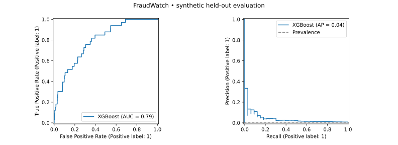

# FraudWatch — streaming fraud detection reference app

A reproducible, SaaS-style ML engineering portfolio project: transaction ingestion,
stream processing, versioned scoring, tenant-scoped analytics and model monitoring.
**Synthetic data only. Not a production fraud prevention system.**

[Project case study](https://jirehandre23.github.io/Portfolio/projects/fraudwatch/)
· [Architecture](docs/ARCHITECTURE.md) · [Interview walkthrough](docs/LEARNING_GUIDE.md)
· [Technical sources](docs/SOURCES.md)

## What this demonstrates

| Layer | Implementation |
|---|---|
| Classification | XGBoost; logistic regression and always-allow baselines |
| Evaluation | Held-out ROC/PR curves, AP, recall, precision, error counts and illustrative costs |
| Model packaging | MLflow Pyfunc wrapper, input signature, run ID and artifact round-trip check |
| Streaming | Kafka → Flink SQL feature transformation → async scoring worker |
| API | FastAPI, async database/Kafka I/O, CPU inference off the event loop |
| Persistence | PostgreSQL, tenant-scoped queries, replay-safe transaction IDs |
| Monitoring | Streamlit, feature PSI, label coverage, labeled performance and decay heuristic |
| Delivery | Docker Compose, unit/API tests and a full-stack smoke-test workflow |

## Quick start — Docker

Requirements: Docker Engine/Desktop with Compose v2, internet access for images and
packages, and approximately 8 GB RAM available. Initial builds download substantial
Python and Java dependencies. All commands below run from this directory.

```bash
cp .env.example .env
docker compose up --build -d
# Wait for training and health checks, then send normal traffic:
docker compose --profile demo run --rm simulator
# Send a deliberately shifted distribution and concept:
docker compose --profile demo run --rm simulator python -m fraudwatch.simulate --count 500 --shift
```

Open:

- Streamlit: http://localhost:8501 — enter the `DEMO_API_KEY` from `.env`.
- API documentation: http://localhost:8000/docs — enter `X-API-Key` for protected requests.
- MLflow runs: http://localhost:5000.
- Flink job: http://localhost:8081.

The simulator publishes transactions without labels, then waits for scoring and
submits labels separately. The synthetic delay is seconds, not realistic chargeback timing.
A `decision=true` means **flag for review**, not an automatic payment block.

```bash
# Validate the real streaming path and replay behavior:
docker compose run --rm --no-deps api python scripts/smoke.py
# Inspect failures:
docker compose logs api worker flink-submit jobmanager
# Stop services, preserving demo data:
docker compose down
# Reset all local demo data and models (destructive to these demo volumes only):
docker compose down -v
```

Start from a clean stack for each new demo. Re-running `up` may rerun the one-shot
training/submission containers; do not submit the same Flink pipeline twice into a
running cluster. Stop the full stack before restarting it. This single-host demo has
no automated deployment or model-promotion controller.

## Local model-only route

Python 3.11 recommended (the initial local verification used Python 3.12).

```bash
python -m venv .venv
# Linux/macOS:
source .venv/bin/activate
# Windows PowerShell alternative: .venv\Scripts\Activate.ps1
pip install -r requirements.txt
python -m pytest -q
python -m fraudwatch.train
```

Training writes the model to `artifacts/model`, run metadata to
`artifacts/metadata.json`, and test evidence to `reports/`. Model artifacts, keys
and generated databases are excluded from git.

## Initial measured results

Seed 42; 30,000 generated examples; 18,000 train / 6,000 validation / 6,000 test.
There are **33 positive test examples (0.55%)**, so estimates are noisy.

| Held-out measure | XGBoost | Logistic regression | Always allow |
|---|---:|---:|---:|
| ROC AUC | 0.7927 | 0.7403 | 0.5000 |
| Average precision | 0.0411 | 0.0614 | 0.0055 |
| Recall at selected threshold | 3.03% | 12.12% | 0% |
| False positives | 5 | 35 | 0 |
| Missed fraud examples | 32 | 29 | 33 |
| Illustrative error cost | 3,225 | 3,075 | 3,300 |

**Interpretation:** XGBoost has better ROC ranking here, but logistic regression wins
on AP and the selected cost measure. The XGBoost service is retained to demonstrate
the requested stack, not because it is the best deployable fraud model. Low recall
and the small positive sample prevent any production-quality claim. No threshold
was retuned after inspecting test results. A real promotion decision would require
representative data, more positive examples, calibration and a business-approved
cost model. These findings are part of the project, not hidden behind accuracy.



See [machine-readable results](reports/evaluation.json). “PR-ROC” is interpreted here
as **precision-recall and ROC curves**. Average precision is reported separately;
it is not described as trapezoidal PR AUC.

## Reliability and safety of the demo

- Per-tenant API keys and query filters; no customer IDs are trusted from request bodies.
- A database primary key and payload hash make repeated transactions idempotent.
- Worker offsets are committed only after persistence or acknowledged dead-letter output.
- Both raw and enriched features use the same log-amount formula, with a parity guard.
- No real payment information, card numbers or personal data is included.
- No claims of measured throughput, latency, production readiness or proven business savings.

See [architecture trade-offs](docs/ARCHITECTURE.md) for the exact failure semantics,
security limitations and next engineering increments.

## Verification

Local unit/API checks: **10 passed**. Training, evaluation, artifact saving/loading
and prediction parity were executed. The current execution environment has no Docker
daemon, so local full-stack verification is unavailable. The included GitHub Actions
workflow runs Docker Compose and the end-to-end smoke test; consult the actual run
status rather than treating the presence of CI configuration as a passing result.

## Ownership and learning

Created for Jireh Andre Bitangila's portfolio with AI assistance. The repository
includes a [step-by-step learning guide](docs/LEARNING_GUIDE.md) for explaining,
modifying and defending the engineering choices in an interview.
