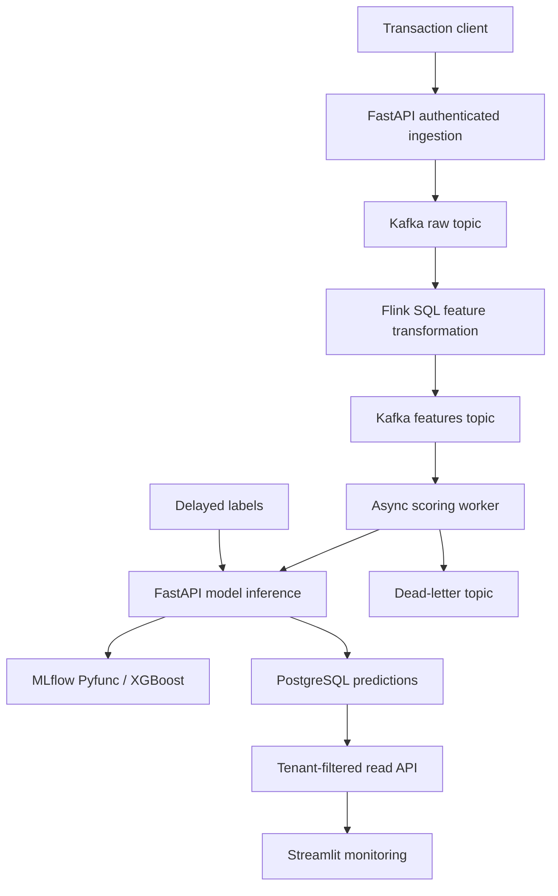

# Architecture and trade-offs

## Public browser demonstration

GitHub Pages serves a numeric tree ensemble exported from the trained XGBoost model.
`web/scorer.mjs` applies the same input validation and log-amount transformation,
walks the exported trees, and converts the margin to a binary-logistic score. Float32
feature comparisons and margin accumulation are tested against Python predictions.
This browser session has no backend or persistent transaction store. Synthetic
sample labels are revealed separately for educational metrics; they are never model
features. The model's weak held-out recall remains documented and unchanged.

`web/model.json` records the original model hash and run version. Regenerate it with
`scripts/export_web.py` after training. The backend uses the MLflow artifact rather
than this browser representation. Full-stream integration and browser inference are
separate verification paths.

## Data path

The synchronous `/score` path bypasses Kafka and Flink for interactive scoring.
The asynchronous `/transactions` path returns 202 only after Kafka acknowledgement.
Flink performs the same log-amount transformation used by training; the API checks
numerical parity before inference. Flink is deliberately a small transformation
stage, not an unnecessary claim of a distributed feature store. No historical
velocity features or event-time windowing are implemented in v1.

## Failure and consistency semantics

- Kafka and Flink use **at-least-once** delivery. No end-to-end exactly-once claim.
- The worker commits its consumer offset after durable scoring or acknowledged DLQ
  publication. Transient HTTP failures are retried; exhaustion terminates the worker
  without committing so a restart replays the event.
- PostgreSQL uses `(tenant_id, transaction_id)` as a primary key. Retries return
  the original prediction and model version. Reusing an ID with changed payload
  returns 409, including races between simultaneous inserts.
- Malformed enriched records and permanent 409/422 failures go to a DLQ. Malformed
  raw JSON stops Flink rather than silently discarding data. In normal usage the
  ingestion API validates raw records; direct Kafka producers must honor the schema.
- Local checkpoints are not a durable disaster-recovery strategy. Cluster loss may
  cause replay from earliest retained Kafka data. Deduplication is in PostgreSQL.
- `GET /health` checks DB access and startup-loaded model availability, not full
  pipeline health. Check the Flink UI, consumer lag and DLQ separately.

## Tenant isolation and security boundary

Tenant IDs are derived from API keys, never accepted from HTTP bodies. All reads,
updates and deduplication keys include the authenticated tenant. The worker is a
trusted internal service with the demo tenant key mapping. API isolation has tests;
PostgreSQL row-level security is **not** configured. The database and Kafka are not
published to host ports. Web UIs bind to localhost only.

This is a local SaaS-style reference app, not a hosted multi-tenant service. API
keys in `.env.example` are public demonstration credentials. There is no billing,
user signup, key rotation, role separation for label writers, TLS, rate limiting,
secrets manager, broker authentication or hardened non-root app image. Add these
before exposing a real service. Never use real payment or personal data here.

## Model and monitoring

The synthetic generator has an explicit stochastic label mechanism and no personal
information. Splits are ordered 60/20/20; generated row order is not real transaction
time, so this is not evidence of temporal generalization. The validation set selects
a threshold using illustrative costs of 5 per false positive and 100 per missed
fraud. Test data is used only for evaluation. A logistic regression and always-allow
policy provide context. The scores are not independently probability-calibrated.

ROC AUC measures ranking across thresholds. Average precision (AP) summarizes the
precision-recall curve; it is **not** trapezoidal PR AUC. The latter is not reported.
AP's no-skill reference is prevalence. Both curves are generated from held-out data.

Streamlit reports PSI using reference bins, label coverage, and labeled performance.
A 20% relative AP drop is a demonstration heuristic, not a statistically validated
alert. Drift is not proof of decay. Label delays, selective labels, prevalence changes
and small samples can change observed metrics. No automatic retraining is performed.
The dashboard filters to one model version; its reference belongs to the current
artifact only. Historical model monitoring would require versioned references.

## Next production increments

1. Add representative transaction data with documented permission and licensing.
2. Add event-time velocity features, watermarks, late-event handling and offline/online parity tests.
3. Add calibrated probabilities, confidence intervals and business-approved costs.
4. Add durable checkpoints, broker replication, migrations, least-privilege DB roles and RLS.
5. Benchmark end-to-end p50/p95 latency and throughput under a documented load.
6. Add drift investigation workflow, observability, auth hardening and CI dependency scanning.
